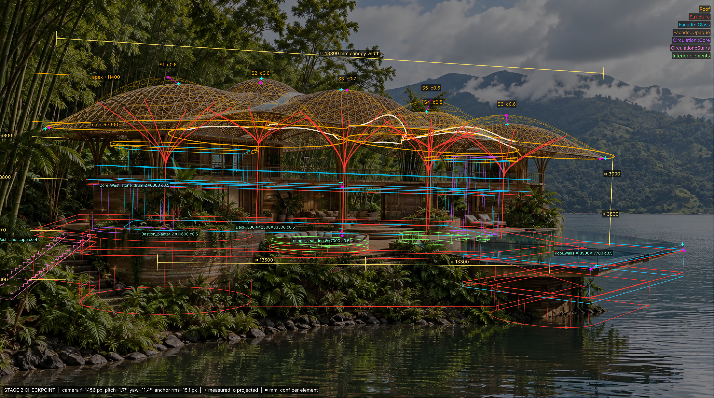
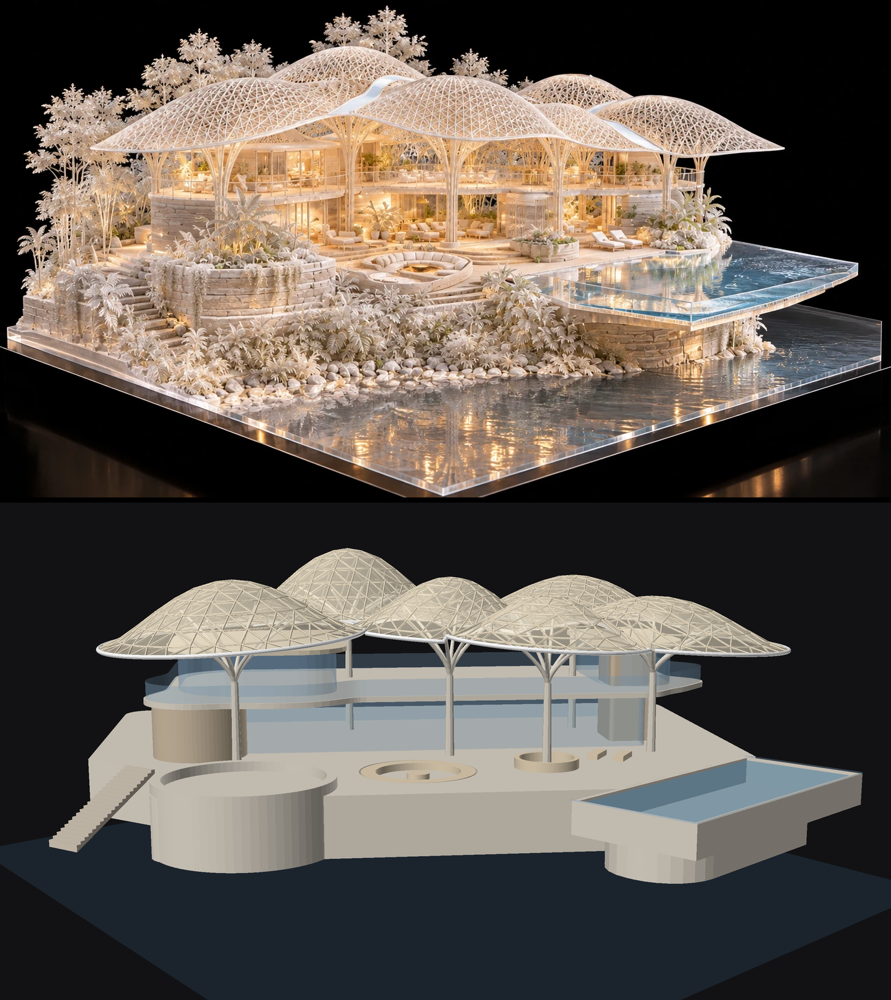
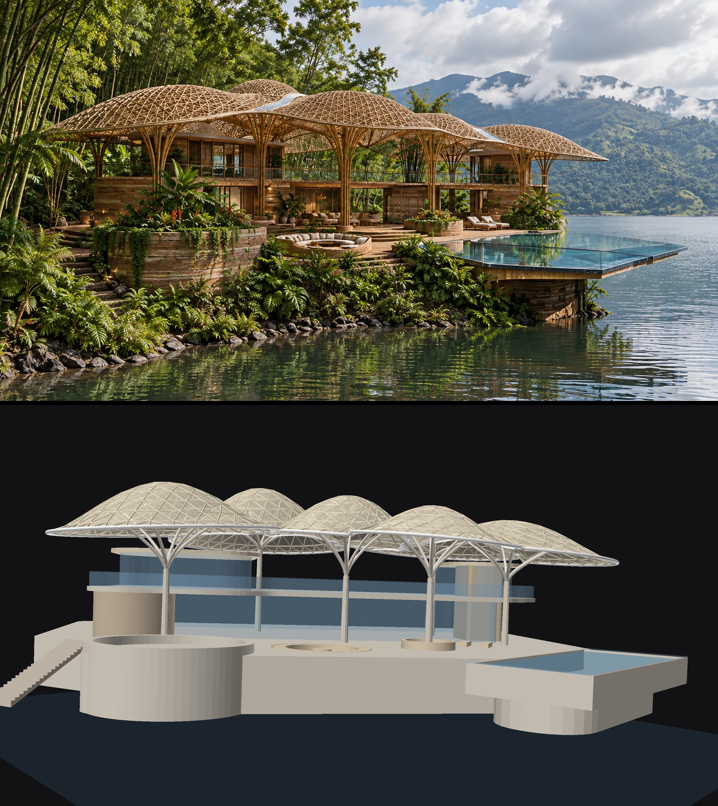
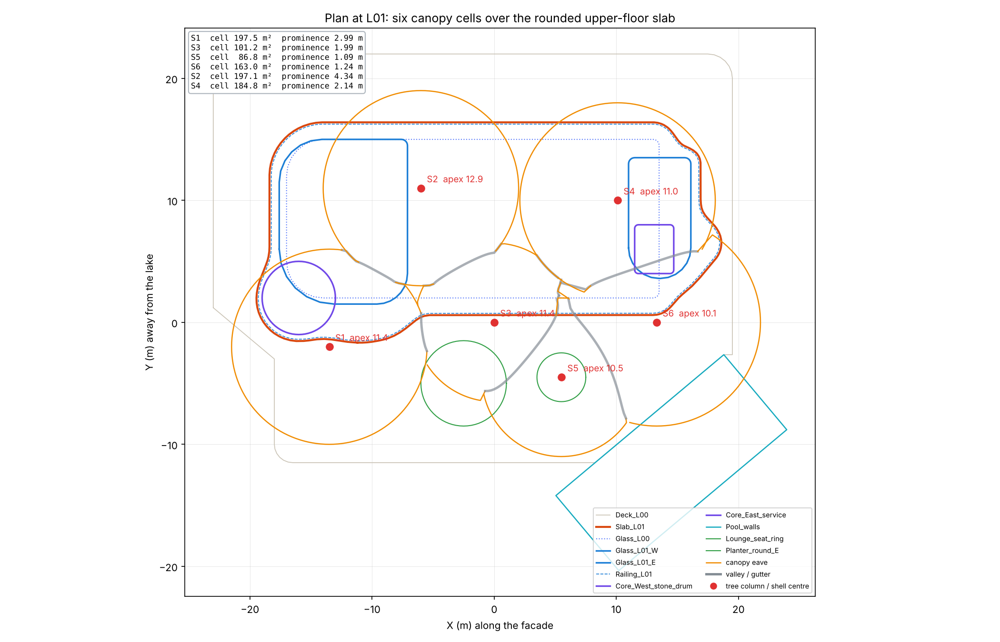

# MVM Canopy Pavilion: image → JSON → Rhino → Grasshopper

A concept model built from two AI images: a photo of the physical model (`spec/source_image.webp`) and a photoreal render on the lake (`spec/reference_image_2.webp`). It follows the hybrid image-to-model pipeline: extract a JSON spec, check it against both images, build it in one script, then verify it from a matched camera per image.




## Design reading

- **Parti:** a cluster of six gridshell umbrellas. Each one sits on a dendriform tree column and floats over a two-storey glass pavilion on a stone plinth, at the corner of a promontory.
- **Roof logic:** the roof is the upper envelope of the domes. Neighbouring domes therefore meet along valleys, which carry the white gutters seen in the image, and the plan becomes a Voronoi-like tiling. Moving a point re-tiles the whole roof.
- **Shell profile:** a bell curve `z = e(x,y) + (apex − e)·(1 − (r/R)^p)^k`. With `k > 1` the eave flares into a thin cantilevered lip, as in the source.
- **Inclined rims:** each dome's rim lies on a plane tilted about 3.6° (rise = R/16). The rims rise toward the heart of the cluster at the S1|S3|S2 valley and droop at the free outer tips. I measured this pattern in both images: the rim runs from about 6.8 m at the east tip to about 9.4 m at the S1|S3 gutter mouth. The gutters therefore fall outward to the valley mouths, where the downpipes go. The central deck stays high and open, the low outer tips shade morning and evening sun, and the lattice triangles stay planar. You can set the tilt in the spec (`canopy.module.tilt`: radial, global or per shell) or with the Grasshopper inputs `tilt_rise` and `tilt_dir`.
- **Gridshell:** a triangulated polar net made only of planar triangles, so glass or ETFE infill needs no cold-bending. The members follow the cell boundary exactly, so the edge members are the gutters and eave beams.
- **Six domes:** front S1, S3, S6; a smaller, lower S5 sits between S3 and S6, and its tree rises out of the round planter. At the back are S2 (the tallest) and S4, which is hidden from image 2, as in the photo. `dome_report` checks that every dome has at least an 86 m² plan cell and stands at least 1.09 m above its valleys.
- **Upper floor (L01):** the slab edge is a smooth blend of shapes tied to the stone drum, S1 and S6. It wraps the drum, pushes forward under S1, runs straight just behind the S3 and S5 trunks, and steps back into a rounded east tip at S6. When those points move, the edge follows. The railing follows the slab. The upper floor is a rounded west pod and an east pod, with an open deck between them under the canopy, as in both images.
- **Trees:** six branches per trunk. A branch that would clash with a pod roof or with the 2.4 m headroom over the open deck shortens its reach. Trees that stand in the building branch above it.
- **Market and acceptance:** one repeatable shell module (one node family, prefab-friendly) gives an iconic, biophilic, shaded roof. The conventional enclosure below keeps cost and risk low. The canopy is PV/ETFE-ready, and the gap between canopy and roof ventilates by stack effect in a tropical climate.

## Pipeline status

| Stage | Output | State |
|---|---|---|
| 1 Extraction | `spec/pavilion_spec.json` holds levels, grids, canopy, trees and the elements, with `conf` per item and `meta.flags`. `tools/fit_camera.py` fits one camera per image: image 1 to 12 anchors (rms 10.6 px), image 2 to 11 anchors (rms 15.1 px). | done |
| 2 Checkpoint | `out/stage2_overlay_img1.png` and `out/stage2_overlay_img2.png` show the projected spec, colour-coded by layer, with ≈ mm dimensions, level tags and anchor residuals. `out/plan_L01.png` shows the canopy cells over the L01 slab and the pods. | **awaiting your review** |
| 3 Modelling | `rhino/mvm_build_rhino.py` builds the model in one call. `grasshopper/mvm_pavilion_gh.py` is the parametric component. `out/mvm_pavilion.3dm` was exported offline. | done |
| 4 Verification | `out/stage4_compare_img1.png` and `out/stage4_compare_img2.png` each compare a source image with the render from its matched camera. `out/render_aerial.png` is an aerial view. | done, revision 2 (checked by independent verifiers) |





## Checkpoint: decisions for you

1. **Scale:** the storey height (3.8 m) and lounger references agree. The railing reads 1.7× too small. Confirm the storey reference.
2. **Canopy plan:** six domes: front S1, S3, S6; S5 small and low between S3 and S6; back S2 (tallest) and S4. Depth (Y) is weakly constrained, so drag the points in Grasshopper.
3. **Design delta:** the canopy sits above the pure image fit: mean eave 7.9 m, inclined rims from 6.8 to 9.4 m, apex 11.4 m. The canopy clears the pod roofs by at least 0.93 m and the deck headroom by at least 0.92 m. The dome rise is now about 3.5 m; the images show about 3.1–3.3 m.
4. **Enclosure:** the ground floor is 30.5 × 13 m. The upper floor is two pods at L01 +3.8 m with roofs at L02 +6.8 m, and an open deck between them. The back of the building is not visible in either image.
5. **Orientation:** the pool and site plate are rotated about 40° to the facade, so the pavilion faces the promontory corner. Keep this, or align everything orthogonally?

Corrections go in as small JSON edits (delta), followed by a rerun. Nothing else needs to change.

## Layers (fixed standard)

`Massing` · `Structure` (deck, plinth walls, slabs, tree columns, pool) · `Roof` (skin, lattice, gutters, eave beams, roof slab) · `Facade::Glass` · `Facade::Opaque` (empty in v1) · `Circulation::Core` / `::Stairs` · `Interior elements`. Every object is named with the `MVM_` prefix. Vegetation, rocks, water and the acrylic plate get no geometry; they are listed in `meta.flags`.

## Run

```bash
pip install -r tools/requirements.txt
cd tools
python fit_camera.py        # Stage 1b: one camera per view + residuals -> spec meta.views
python overlay.py           # Stage 2: out/stage2_overlay_<view>.png
python plan.py              # Stage 2: out/plan_L01.png
python make_scripts.py      # Stage 3: regenerate Rhino + Grasshopper scripts from spec + core
python build_3dm.py         # Stage 3 (offline): out/mvm_pavilion.3dm
python smoke_test_scripts.py
python render.py            # Stage 4: out/stage4_compare_<view>.png, out/render_aerial.png
```

**Rhino 8:** run `rhino/mvm_build_rhino.py` in the ScriptEditor, or send it as one MCP call. It is idempotent: it first purges earlier `MVM_` objects, including hidden ones, locked ones and ones on switched-off layers. It ends with one `REPORT:` line: counts per layer, a solid check, and canopy clearance over each pod roof and over the deck headroom. For MCP servers that only return success or failure, set `REPORT_AS_ERROR = True`.

**Grasshopper:** create a Script component (Python 3) and paste in `grasshopper/mvm_pavilion_gh.py`. Add these optional inputs: `spec_path, centers (list), R, eave, apex, profile_k, tilt_rise, tilt_dir, rings, member_len, branches, branch_z, reach, L01, L02, skin`. Add these outputs: `roof, lattice, structure, glass, opaque, cores, stairs, interior, massing, report`. Numbers are in mm, and points are in model units. Units scale automatically.

## Source map

- `core/mvm_core.py` is the geometry engine: pure Python with no Rhino imports. The Rhino script, the GH component and the `.3dm` export all use it. Outlines can be `rrect`, `circle`, `poly`, `ref` (another element, optionally grown) or `blob`. A `blob` is a smooth union of shapes and capsules, which can be tied to dome or element IDs.
- `rhino/rhino_adapter.py` converts primitives to RhinoCommon geometry (Breps, pipes, meshes).
- `rhino/build_main.py` and `grasshopper/gh_main.py` are the entry points. The generated scripts embed them, so edit the sources and regenerate rather than editing the generated files.
- The `tools/` folder holds the camera fit, overlays, plan diagram, `.3dm` exporter, renderer and smoke test.

## Next

- Optional canopy refinement: an extra upsweep of +0.3 to 0.8 m where the rims meet the inner gutter mouths (S1|S3 and S3|S5). Both images show it. I left it out of the base rule so the rims stay planar and the edge beams simple.
- Fidelity items found by the image readers: bundled multi-stem trunks, a three-riser veranda at L00, a thinner glass pool tray, a sloped planted bank in place of the plinth wall, and a denser lattice.
- Native Grasshopper definition (`.gh`): Voronoi cells, Kangaroo form-finding of the shells, panel planarity check, PV yield on the skin.
- Revit via Rhino.Inside.Revit, using the layer → category mapping: trees → structural columns, lattice → framing, skin → roof/curtain panels.
