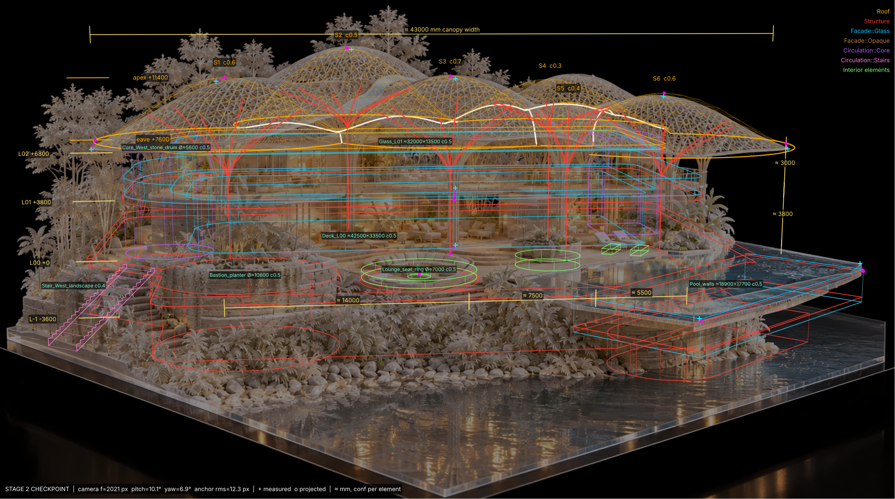
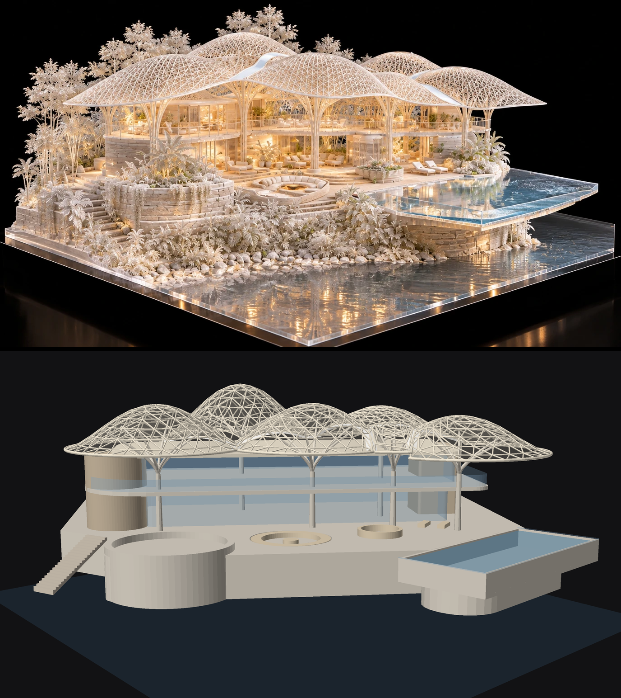

# MVM Canopy Pavilion: image → JSON → Rhino → Grasshopper

A concept model built from one AI-rendered model photo (`spec/source_image.webp`). It follows the hybrid image-to-model pipeline: extract a JSON spec, check it against the image, build it in one script, then verify it from a matched camera.



## Design reading

- **Parti:** a cluster of six gridshell umbrellas. Each one sits on a dendriform tree column and floats over a two-storey glass pavilion on a stone plinth, at the corner of a promontory.
- **Roof logic:** the roof is the upper envelope of the domes. Neighbouring domes therefore meet along valleys, which carry the white gutters seen in the image, and the plan becomes a Voronoi-like tiling. Moving a point re-tiles the whole roof.
- **Shell profile:** a bell curve `z = eave + (apex − eave)·(1 − (r/R)^p)^k`. With `k > 1` the eave flares into a thin cantilevered lip, as in the source.
- **Gridshell:** a triangulated polar net made only of planar triangles, so glass or ETFE infill needs no cold-bending. The members follow the cell boundary exactly, so the edge members are the gutters and eave beams.
- **Trees:** six branches per trunk. A branch that would clash with the enclosure shortens its reach. Trees that stand inside the building branch above the roof.
- **Market and acceptance:** one repeatable shell module (one node family, prefab-friendly) gives an iconic, biophilic, shaded roof. The conventional enclosure below keeps cost and risk low. The canopy is PV/ETFE-ready, and the gap between canopy and roof ventilates by stack effect in a tropical climate.

## Pipeline status

| Stage | Output | State |
|---|---|---|
| 1 Extraction | `spec/pavilion_spec.json` holds levels, grids, canopy, trees and 22 elements, with `conf` per item and `meta.flags`. `tools/fit_camera.py` fits a pinhole camera to 11 anchors (rms 12.3 px). | done |
| 2 Checkpoint | `out/stage2_overlay.png` shows the projected spec, colour-coded by layer, with ≈ mm dimensions, level tags and anchor residuals. | **awaiting your review** |
| 3 Modelling | `rhino/mvm_build_rhino.py` builds the model in one call. `grasshopper/mvm_pavilion_gh.py` is the parametric component. `out/mvm_pavilion.3dm` was exported offline. | done |
| 4 Verification | `out/stage4_compare.png` compares the source with the matched-camera render. `out/render_aerial.png` is an aerial view. | done, 2 delta rounds |



## Checkpoint: decisions for you

1. **Scale:** the storey height (3.8 m) and lounger references agree. The railing reads 1.7× too small. Confirm the storey reference.
2. **Canopy plan:** six domes (front S1 S3 S5 S6, back S2 S4). S2 is the tall "hero" dome and S5 is a small dome in the valley. Depth (Y) is weakly constrained, so drag the points in Grasshopper.
3. **Design delta:** the canopy was raised 700 mm over the pure image fit (eave 7.6 m, apex 11.4 m), so the eaves clear the L02 roof by at least 800 mm.
4. **Enclosure:** 30.5 × 13 m over two floors, L01 +3.8 m, roof L02 +6.8 m, with a 2–3 m wrap-around balcony. None of this is visible at the back of the image.
5. **Orientation:** the pool and site plate are rotated about 40° to the facade, so the pavilion faces the promontory corner. Keep this, or align everything orthogonally?

Corrections go in as small JSON edits (delta), followed by a rerun. Nothing else needs to change.

## Layers (fixed standard)

`Massing` · `Structure` (deck, plinth walls, slabs, tree columns, pool) · `Roof` (skin, lattice, gutters, eave beams, roof slab) · `Facade::Glass` · `Facade::Opaque` (empty in v1) · `Circulation::Core` / `::Stairs` · `Interior elements`. Every object is named with the `MVM_` prefix. Vegetation, rocks, water and the acrylic plate get no geometry; they are listed in `meta.flags`.

## Run

```bash
pip install -r tools/requirements.txt
cd tools
python fit_camera.py        # Stage 1b: camera + residuals -> spec meta
python overlay.py           # Stage 2: out/stage2_overlay.png
python make_scripts.py      # Stage 3: regenerate Rhino + Grasshopper scripts from spec + core
python build_3dm.py         # Stage 3 (offline): out/mvm_pavilion.3dm
python smoke_test_scripts.py
python render.py            # Stage 4: out/stage4_compare.png, out/render_aerial.png
```

**Rhino 8:** run `rhino/mvm_build_rhino.py` in the ScriptEditor, or send it as one MCP call. It is idempotent: it first purges earlier `MVM_` objects, including hidden ones, locked ones and ones on switched-off layers. It ends with one `REPORT:` line (counts per layer, solid check, canopy clearance). For MCP servers that only return success or failure, set `REPORT_AS_ERROR = True`.

**Grasshopper:** create a Script component (Python 3) and paste in `grasshopper/mvm_pavilion_gh.py`. Add these optional inputs: `spec_path, centers (list), R, eave, apex, profile_k, rings, member_len, branches, branch_z, reach, L01, L02, skin`. Add these outputs: `roof, lattice, structure, glass, opaque, cores, stairs, interior, massing, report`. Numbers are in mm, and points are in model units. Units scale automatically.

## Source map

- `core/mvm_core.py` is the geometry engine: pure Python with no Rhino imports. The Rhino script, the GH component and the `.3dm` export all use it.
- `rhino/rhino_adapter.py` converts primitives to RhinoCommon geometry (Breps, pipes, meshes).
- `rhino/build_main.py` and `grasshopper/gh_main.py` are the entry points. The generated scripts embed them, so edit the sources and regenerate rather than editing the generated files.
- The `tools/` folder holds the camera fit, overlay, `.3dm` exporter, renderer and smoke test.

## Next

- Native Grasshopper definition (`.gh`): Voronoi cells, Kangaroo form-finding of the shells, panel planarity check, PV yield on the skin.
- Revit via Rhino.Inside.Revit, using the layer → category mapping: trees → structural columns, lattice → framing, skin → roof/curtain panels.
